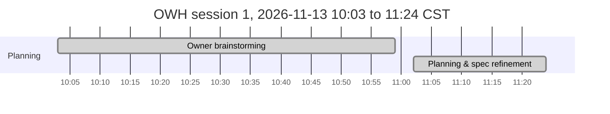

# OWH: OpenWebUI Hybrid Implementation Plan

**Spec:** [`docs/OWH_SPECIFICATION.md`](docs/OWH_SPECIFICATION.md). **Decisions:** [`docs/OWH_DECISIONS.md`](docs/OWH_DECISIONS.md). **Agent rules:** [`CLAUDE.md`](CLAUDE.md). **Shared phase instructions:** [`prompts/OWH_shared-instructions.md`](prompts/OWH_shared-instructions.md)
**Last updated:** 2026-11-13 11:20 CST (Phase 00, planning)

> ⚠️ **Mandatory:** every agent that works on this project keeps this file accurate. **Before doing any other work, set your phase to `🔄 In progress` and commit that change to `main`** (claim protocol: `prompts/OWH_shared-instructions.md` §1a). Other agents read this table from `main`. At the end, set it to `✅ Complete` or `⛔ Blocked` and add a Phase Log entry. See `CLAUDE.md`.

## How to run a phase
Open Claude Code in `/home/nick/Work/OpenWebUI` and type one of:
- `/phase`: run the next eligible phase. It checks dependencies, tells you if you're on the wrong model, resumes an `In progress` phase, and asks about any open questions it needs.
- `/phase NN`: run a specific phase.
- `/phase status`: show progress and what's next, without doing any work.
- `/phase-add [after NN] <request or file>`: plan a new lettered phase (`07a`) from a change request. No product work, no claim.

**Optional hands-off runs (PhaseHypervisor):** `phx preflight /home/nick/Work/OpenWebUI` asks the foreseeable questions once, then `phx run /home/nick/Work/OpenWebUI` runs the remaining phases unattended through `/phase NN --auto`, honouring the Gate column. Manual `/phase` stays the standard way; you can switch between the two at any phase boundary, and `/phase` stops if a `phx` supervisor is running this plan.

The agent merges a completed phase into `main` and pushes it without asking (Nick's standing git authority); review its close-out summary.

Each phase is claimed by a `chore(plan): start phase NN` commit on `main` and runs in its own worktree, `../OpenWebUI-phase-NN`, so parallel sessions never share a checkout. `/phase status` flags any branch or worktree whose row is not `🔄 In progress`.

**Parallelism:** after Phase 01, Phases **02** (tool scaffold) and **03** (verification spike) can run in parallel in separate sessions; they touch different files (02: `pyproject.toml`, `src/`, `tests/`, CI; 03: `docs/OWH_FINDINGS.md`, `scripts/owh-testbed.sh`, ADRs). Everything else is sequential.

**Gate column** (read only by PhaseHypervisor; manual `/phase` ignores it): `auto` = may run unattended; `review` = pause for Nick after it; `owner` = Nick starts it. Empty means `auto`.

**Status values:** ⬜ Not started · 🔄 In progress · ⛔ Blocked · ✅ Complete. Always write the icon **and** the word.

## Phases

| Phase | Phase Name | Phase Purpose | AI Model to Use | Depends on | Status | Prompt to Initiate This Phase | Gate |
|---|---|---|---|---|---|---|---|
| 00 | Planning & spec refinement | Review source docs, resolve decisions, write the spec, plan and prompts | Opus 5.5 (`/model opus`) | none | ✅ Complete | n/a (planning session) | owner |
| 01 | Repository foundation & governance | Governance files, secret-scan hook, private GitHub repo | Sonnet 5.5 (`/model sonnet`) | 00 | ⬜ Not started | [`prompts/OWH_phase-01-repo-foundation.md`](prompts/OWH_phase-01-repo-foundation.md) | auto |
| 02 | Tool scaffold & quality gates | uv project, CLI skeleton, fakes, pytest/ruff/shellcheck/gitleaks in CI | Sonnet 5.5 (`/model sonnet`) | 01 | ⬜ Not started | [`prompts/OWH_phase-02-tool-scaffold.md`](prompts/OWH_phase-02-tool-scaffold.md) | auto |
| 03 | Verification spike | Prove Open WebUI 0.13.3 and OpenRouter API facts on a throwaway container; propose the model shortlist | Opus 5.5 (`/model opus`) | 01 | ⬜ Not started | [`prompts/OWH_phase-03-verification-spike.md`](prompts/OWH_phase-03-verification-spike.md) | auto |
| 04 | `owh-openrouter` CLI | `set-key`, `models`, `apply`, `status`, `remove`; idempotent, snapshot/restore, tested against fakes and the testbed | Opus 5.5 (`/model opus`) | 02, 03 | ⬜ Not started | [`prompts/OWH_phase-04-owh-openrouter-cli.md`](prompts/OWH_phase-04-owh-openrouter-cli.md) | auto |
| 05 | Rehearsal & live deploy | Real key, rehearsal on the testbed, backup, apply to the live instance, verify both backends in the UI, OSMods docs | Opus 5.5 (`/model opus`) | 04 | ⬜ Not started | [`prompts/OWH_phase-05-rehearsal-and-live-deploy.md`](prompts/OWH_phase-05-rehearsal-and-live-deploy.md) | owner |
| 06 | Hardening, security & QA | Threat model, secret scans, upgrade survival, offline behaviour, spend guard, exposure review, follow-ups | Opus 5.5 (`/model opus`) | 05 | ⬜ Not started | [`prompts/OWH_phase-06-hardening-and-qa.md`](prompts/OWH_phase-06-hardening-and-qa.md) | review |
| 07 | Release & handover | User guide, final report with timeline, CHANGELOG 1.0.0, vault and OSMods final, private repo pushed | Sonnet 5.5 (`/model sonnet`) | 06 | ⬜ Not started | [`prompts/OWH_phase-07-release-and-handover.md`](prompts/OWH_phase-07-release-and-handover.md) | review |

## Timeline
Generated by `scripts/phase_timeline.py` from the Phase Log and git; refreshed on `main` at every close-out, block, resume and `/phase-add`. Do not edit between the markers.

<!-- phase-timeline:start (generated by scripts/phase_timeline.py; do not edit) -->


*Generated from the Phase Log Timeline bullets and git, as of 2026-11-13 11:24 CST. ≈ marks a time inferred from git or a heading. Idle gaps over 60 min start a new chart below and are collapsed in the image. Regenerate with `python3 scripts/phase_timeline.py --write`; do not edit by hand.*



| Phase | Name | Started | Finished | Merged | Active | Blocked | Claim |
|---|---|---|---|---|---:|---:|---|
| plan | Owner brainstorming | 2026-11-13 10:03 CST | 10:59 |  | 56 m |  | n/a |
| 00 | Planning & spec refinement | 2026-11-13 11:02 CST | 11:24 |  | 22 m |  | n/a |

**Totals:** elapsed 1 h 21 m (first recorded start to 2026-11-13 11:24 CST) · active phase time < 1 m (sum over phases) · blocked or paused 0 m · idle 0 m in 0 gap(s) over 60 min.

**Not started:** 01, 02, 03, 04, 05, 06, 07.
<!-- phase-timeline:end -->

### Model rationale
- **Opus 5.5** for 03 (reading Open WebUI's real behaviour and API shapes correctly is the foundation of everything after it), 04 (idempotent config merge, snapshot/restore round-trip, secret handling), 05 (changes a live instance holding Nick's data; judgment over risk) and 06 (security review).
- **Sonnet 5.5** for 01 and 02 (well-specified scaffolding, governance files and CI) and 07 (docs and packaging).

### Dependency graph
```
00 ──> 01 ──┬──> 02 ──┐
            └──> 03 ──┴──> 04 ──> 05 ──> 06 ──> 07
            (02 ∥ 03)
```

### Definition of done (checked in the final phase)
- [ ] The Open WebUI model picker shows the local Ollama models **and** the allowlisted OpenRouter models (prefixed); picking either one gets a reply from that backend (verified in the live UI and in OpenRouter Activity for the dedicated key).
- [ ] New chats still default to the local model; titles, tags and follow-ups are generated locally (ADR-0005 outcome).
- [ ] With OpenRouter unreachable, local models still list and work; the measured model-list delay is recorded.
- [ ] The configuration survives a container recreate on the same volume (`open-webui-upgrade` path) with no change to that script.
- [ ] `owh-openrouter apply` is idempotent; `remove` restores the pre-apply values exactly (verified on the testbed).
- [ ] The key is in none of: the repo and its history (gitleaks clean), logs, `docker inspect`, shell history, process lists.
- [ ] The dedicated key has a spending limit; the OpenRouter privacy settings match Nick's answer.
- [ ] Docs current: README, user guide, SECURITY, `docs/OWH_ARCHITECTURE.md`, `docs/OWH_FINAL-REPORT.md` (with the generated timeline), CHANGELOG, OSMods (`Open WebUI.md` + README), vault note.
- [ ] Private GitHub repo `antonizick/OpenWebUI` up to date; every throwaway container, volume and test file removed.

## Owner questions
| # | Question | Status / proposed default | Needed by |
|---|---|---|---|
| 1 | Which OpenRouter models go on the allowlist? | Open (asked 2026-11-13 11:20 CST). Phase 03 proposes a shortlist with live prices; Nick confirms | Phase 05 |
| 2 | Spending limit for the new dedicated key | Open (asked 2026-11-13 11:20 CST). Proposed default: $20/month, set on openrouter.ai at key creation | Phase 05 |
| 3 | OpenRouter account privacy: allow providers that log or train on prompts? | Open (asked 2026-11-13 11:20 CST). Proposed default: disallow training/logging providers; ZDR-only off | Phase 05 |
| 4 | Licence, if the repo is ever made public | Deferred (2026-11-13 11:20 CST). Default: private, "All rights reserved" | Phase 07 |

## Phase Log
Newest entries at the bottom. Format: `### YYYY-MM-DD HH:MM TZ: Phase NN: <title> (<status>)` (timestamp from `date '+%Y-%m-%d %H:%M %Z'`, never a bare date). **The first bullet is always the Timeline:** `- **Timeline:** started <TS> (claim commit <hash>) · finished <TS> · merged <TS | not merged yet>` (add ` · blocked <TS> to <TS>` per `⛔` interval; *started* is the claim commit's time). Then bullets: built, deviations, follow-ups, tests.

### 2026-11-13 11:20 CST: Planning: owner brainstorming (✅ Complete)
- **Timeline:** started 2026-11-13 10:03 CST · finished 2026-11-13 10:59 CST
- Nick's own pre-planning, recorded at his request (ADR-0008). Times are the two timestamped entries in `OWH_Brainstorming.md`: 10:03 CST (drafting a prompt for this capability with another AI) and 10:59 CST (the final request sent to Claude Code, quoted in spec §1).
- No repo or system changes; the output is the request that Phase 00 planned from.

### 2026-11-13 11:20 CST: Phase 00: Planning & spec refinement (✅ Complete)
- **Timeline:** started 2026-11-13 11:02 CST · finished 2026-11-13 11:24 CST
- Read `OWH_Brainstorming.md`, the OSMods notes `Open WebUI.md` and `AI Provider Switch.md`, `OpenRouter Analysis.md`, the user units and the live container/DB config (read-only). Found: Open WebUI v0.13.3 in Docker (host network, volume `open-webui`); a dead stored OpenAI connection (`api.openai.com`, empty key); background tasks run on the chat model (`task.model.external=""`).
- Owner decisions (one round): prefix `OWH`; a new dedicated OpenRouter key; a curated prefixed allowlist; configuration scripted via the admin API (ADR-0001…0004). Proposed ADR-0005 (local task model); planning defaults ADR-0006 (stdlib Python CLI), ADR-0007 (throwaway rehearsal), ADR-0008 (brainstorming in the timeline).
- Wrote spec with Amendments (A1–A4, R1–R9, S1–S7), ADR log, this plan (7 build phases), shared instructions, 7 phase prompts, `CLAUDE.md`, `/phase`, `/phase-add`, change-request template, vault note `02 Projects/OWH Implementation Plan.md`.
- Open questions: 1–3 needed by Phase 05; 4 deferred.
- No host system changes in Phase 00. Repo is local only until Phase 01 creates the private GitHub repo.
