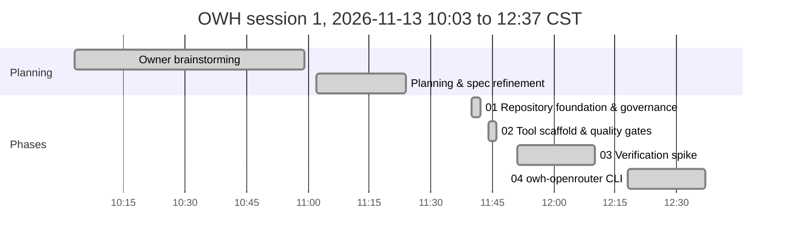

# OWH: OpenWebUI Hybrid Implementation Plan

**Spec:** [`docs/OWH_SPECIFICATION.md`](docs/OWH_SPECIFICATION.md). **Decisions:** [`docs/OWH_DECISIONS.md`](docs/OWH_DECISIONS.md). **Agent rules:** [`CLAUDE.md`](CLAUDE.md). **Shared phase instructions:** [`prompts/OWH_shared-instructions.md`](prompts/OWH_shared-instructions.md)
**Last updated:** 2026-11-13 12:37 CST (Phase 04 complete)

> ⚠️ **Mandatory:** every agent that works on this project keeps this file accurate. **Before doing any other work, set your phase to `🔄 In progress` and commit that change to `main`** (claim protocol: `prompts/OWH_shared-instructions.md` §1a). Other agents read this table from `main`. At the end, set it to `✅ Complete` or `⛔ Blocked` and add a Phase Log entry. See `CLAUDE.md`.

## How to run a phase
Open Claude Code in `/home/nick/Work/OpenWebUI` and type one of:
- `/phase`: run the next eligible phase. It checks dependencies, tells you if you're on the wrong model, resumes an `In progress` phase, and asks about any open questions it needs.
- `/phase NN`: run a specific phase.
- `/phase status`: show progress and what's next, without doing any work.
- `/phase-add [after NN] <request or file>`: plan a new lettered phase (`07a`) from a change request. No product work, no claim.

**Optional hands-off runs (PhaseHypervisor):** `phx preflight /home/nick/Work/OpenWebUI` asks the foreseeable questions once, then `phx run /home/nick/Work/OpenWebUI` runs the remaining phases unattended through `/phase NN --auto`, honouring the Gate column. Manual `/phase` stays the standard way; you can switch between the two at any phase boundary, and `/phase` stops if a `phx` supervisor is running this plan.

The agent merges a completed phase into `main` and pushes it without asking (Nick's standing git authority); review its close-out summary.

Each phase is claimed by a `chore(plan): start phase NN` commit on `main` and runs in its own worktree, `../OpenWebUI-phase-NN`, so parallel sessions never share a checkout. `/phase status` flags any branch or worktree whose row is not `🔄 In progress`.

**Parallelism:** after Phase 01, Phases **02** (tool scaffold) and **03** (verification spike) can run in parallel in separate sessions; they touch different files (02: `pyproject.toml`, `src/`, `tests/`, CI; 03: `docs/OWH_FINDINGS.md`, `scripts/owh-testbed.sh`, ADRs). Everything else is sequential.

**Gate column** (read only by PhaseHypervisor; manual `/phase` ignores it): `auto` = may run unattended; `review` = pause for Nick after it; `owner` = Nick starts it. Empty means `auto`.

**Status values:** ⬜ Not started · 🔄 In progress · ⛔ Blocked · ✅ Complete. Always write the icon **and** the word.

## Phases

| Phase | Phase Name | Phase Purpose | AI Model to Use | Depends on | Status | Prompt to Initiate This Phase | Gate |
|---|---|---|---|---|---|---|---|
| 00 | Planning & spec refinement | Review source docs, resolve decisions, write the spec, plan and prompts | Opus 5.5 (`/model opus`) | none | ✅ Complete | n/a (planning session) | owner |
| 01 | Repository foundation & governance | Governance files, secret-scan hook, private GitHub repo | Sonnet 5.5 (`/model sonnet`) | 00 | ✅ Complete | [`prompts/OWH_phase-01-repo-foundation.md`](prompts/OWH_phase-01-repo-foundation.md) | auto |
| 02 | Tool scaffold & quality gates | uv project, CLI skeleton, fakes, pytest/ruff/shellcheck/gitleaks in CI | Sonnet 5.5 (`/model sonnet`) | 01 | ✅ Complete | [`prompts/OWH_phase-02-tool-scaffold.md`](prompts/OWH_phase-02-tool-scaffold.md) | auto |
| 03 | Verification spike | Prove Open WebUI 0.13.3 and OpenRouter API facts on a throwaway container; propose the model shortlist | Opus 5.5 (`/model opus`) | 01 | ✅ Complete | [`prompts/OWH_phase-03-verification-spike.md`](prompts/OWH_phase-03-verification-spike.md) | auto |
| 04 | `owh-openrouter` CLI | `set-key`, `models`, `apply`, `status`, `remove`; idempotent, snapshot/restore, tested against fakes and the testbed | Opus 5.5 (`/model opus`) | 02, 03 | ✅ Complete | [`prompts/OWH_phase-04-owh-openrouter-cli.md`](prompts/OWH_phase-04-owh-openrouter-cli.md) | auto |
| 05 | Rehearsal & live deploy | Real key, rehearsal on the testbed, backup, apply to the live instance, verify both backends in the UI, OSMods docs | Opus 5.5 (`/model opus`) | 04 | 🔄 In progress | [`prompts/OWH_phase-05-rehearsal-and-live-deploy.md`](prompts/OWH_phase-05-rehearsal-and-live-deploy.md) | owner |
| 06 | Hardening, security & QA | Threat model, secret scans, upgrade survival, offline behaviour, spend guard, exposure review, follow-ups | Opus 5.5 (`/model opus`) | 05 | ⬜ Not started | [`prompts/OWH_phase-06-hardening-and-qa.md`](prompts/OWH_phase-06-hardening-and-qa.md) | review |
| 07 | Release & handover | User guide, final report with timeline, CHANGELOG 1.0.0, vault and OSMods final, private repo pushed | Sonnet 5.5 (`/model sonnet`) | 06 | ⬜ Not started | [`prompts/OWH_phase-07-release-and-handover.md`](prompts/OWH_phase-07-release-and-handover.md) | review |

## Timeline
Generated by `scripts/phase_timeline.py` from the Phase Log and git; refreshed on `main` at every close-out, block, resume and `/phase-add`. Do not edit between the markers.

<!-- phase-timeline:start (generated by scripts/phase_timeline.py; do not edit) -->


*Generated from the Phase Log Timeline bullets and git, as of 2026-11-13 12:37 CST. ≈ marks a time inferred from git or a heading. Idle gaps over 60 min start a new chart below and are collapsed in the image. Regenerate with `python3 scripts/phase_timeline.py --write`; do not edit by hand.*



| Phase | Name | Started | Finished | Merged | Active | Blocked | Claim |
|---|---|---|---|---|---:|---:|---|
| plan | Owner brainstorming | 2026-11-13 10:03 CST | 10:59 |  | 56 m |  | n/a |
| 00 | Planning & spec refinement | 2026-11-13 11:02 CST | 11:24 |  | 22 m |  | n/a |
| 01 | Repository foundation & governance | 2026-11-13 11:40 CST | 11:42 | 11:42 | 2 m |  | `a9c405b` |
| 02 | Tool scaffold & quality gates | 2026-11-13 11:44 CST | 11:46 | 11:46 | 2 m |  | `9eb5dff` |
| 03 | Verification spike | 2026-11-13 11:51 CST | 12:10 | 12:10 | 19 m |  | `879a1f8` |
| 04 | `owh-openrouter` CLI | 2026-11-13 12:18 CST | 12:37 | 12:37 | 19 m |  | `2bf3c35` |

**Totals:** elapsed 2 h 34 m (first recorded start to 2026-11-13 12:37 CST) · active phase time 42 m (sum over phases) · blocked or paused 0 m · idle 0 m in 0 gap(s) over 60 min.

**Not started:** 05, 06, 07.
<!-- phase-timeline:end -->

### Model rationale
- **Opus 5.5** for 03 (reading Open WebUI's real behaviour and API shapes correctly is the foundation of everything after it), 04 (idempotent config merge, snapshot/restore round-trip, secret handling), 05 (changes a live instance holding Nick's data; judgment over risk) and 06 (security review).
- **Sonnet 5.5** for 01 and 02 (well-specified scaffolding, governance files and CI) and 07 (docs and packaging).

### Dependency graph
```
00 ──> 01 ──┬──> 02 ──┐
            └──> 03 ──┴──> 04 ──> 05 ──> 06 ──> 07
            (02 ∥ 03)
```

### Definition of done (checked in the final phase)
- [ ] The Open WebUI model picker shows the local Ollama models **and** the allowlisted OpenRouter models (prefixed); picking either one gets a reply from that backend (verified in the live UI and in OpenRouter Activity for the dedicated key).
- [ ] New chats still default to the local model; titles, tags and follow-ups are generated locally (ADR-0005 outcome).
- [ ] With OpenRouter unreachable, local models still list and work; the measured model-list delay is recorded.
- [ ] The configuration survives a container recreate on the same volume (`open-webui-upgrade` path) with no change to that script.
- [ ] `owh-openrouter apply` is idempotent; `remove` restores the pre-apply values exactly (verified on the testbed).
- [ ] The key is in none of: the repo and its history (gitleaks clean), logs, `docker inspect`, shell history, process lists.
- [ ] The dedicated key has a spending limit; the OpenRouter privacy settings match Nick's answer.
- [ ] Docs current: README, user guide, SECURITY, `docs/OWH_ARCHITECTURE.md`, `docs/OWH_FINAL-REPORT.md` (with the generated timeline), CHANGELOG, OSMods (`Open WebUI.md` + README), vault note.
- [ ] Private GitHub repo `antonizick/OpenWebUI` up to date; every throwaway container, volume and test file removed.

## Owner questions
| # | Question | Status / proposed default | Needed by |
|---|---|---|---|
| 1 | Which OpenRouter models go on the allowlist? | Answered 2026-11-13 12:16 CST: all five Phase 03 proposals plus three added by Nick, eight in total: `anthropic/claude-sonnet-5.5`, `anthropic/claude-haiku-5.5`, `google/gemini-4-hydrogen`, `openai/gpt-6.1-terra`, `google/gemma-4-31b-it:free`, `deepseek/deepseek-v4.1-flash-1017`, `xiaomi/mimo-v2.6-pro`, `z-ai/glm-5.3-flash` (ADR-0014; prices in `docs/OWH_FINDINGS.md` §7). Phase 05 writes them to `config/openrouter-models.txt` | Phase 05 |
| 2 | Spending limit for the new dedicated key | Open (asked 2026-11-13 11:20 CST). Proposed default: $20/month, set on openrouter.ai at key creation | Phase 05 |
| 3 | OpenRouter account privacy: allow providers that log or train on prompts? | Open (asked 2026-11-13 11:20 CST). Proposed default: disallow training/logging providers; ZDR-only off | Phase 05 |
| 4 | Licence, if the repo is ever made public | Deferred (2026-11-13 11:20 CST). Default: private, "All rights reserved" | Phase 07 |

## Phase Log
Newest entries at the bottom. Format: `### YYYY-MM-DD HH:MM TZ: Phase NN: <title> (<status>)` (timestamp from `date '+%Y-%m-%d %H:%M %Z'`, never a bare date). **The first bullet is always the Timeline:** `- **Timeline:** started <TS> (claim commit <hash>) · finished <TS> · merged <TS | not merged yet>` (add ` · blocked <TS> to <TS>` per `⛔` interval; *started* is the claim commit's time). Then bullets: built, deviations, follow-ups, tests.

### 2026-11-13 11:20 CST: Planning: owner brainstorming (✅ Complete)
- **Timeline:** started 2026-11-13 10:03 CST · finished 2026-11-13 10:59 CST
- Nick's own pre-planning, recorded at his request (ADR-0008). Times are the two timestamped entries in `OWH_Brainstorming.md`: 10:03 CST (drafting a prompt for this capability with another AI) and 10:59 CST (the final request sent to Claude Code, quoted in spec §1).
- No repo or system changes; the output is the request that Phase 00 planned from.

### 2026-11-13 11:20 CST: Phase 00: Planning & spec refinement (✅ Complete)
- **Timeline:** started 2026-11-13 11:02 CST · finished 2026-11-13 11:24 CST
- Read `OWH_Brainstorming.md`, the OSMods notes `Open WebUI.md` and `AI Provider Switch.md`, `OpenRouter Analysis.md`, the user units and the live container/DB config (read-only). Found: Open WebUI v0.13.3 in Docker (host network, volume `open-webui`); a dead stored OpenAI connection (`api.openai.com`, empty key); background tasks run on the chat model (`task.model.external=""`).
- Owner decisions (one round): prefix `OWH`; a new dedicated OpenRouter key; a curated prefixed allowlist; configuration scripted via the admin API (ADR-0001…0004). Proposed ADR-0005 (local task model); planning defaults ADR-0006 (stdlib Python CLI), ADR-0007 (throwaway rehearsal), ADR-0008 (brainstorming in the timeline).
- Wrote spec with Amendments (A1–A4, R1–R9, S1–S7), ADR log, this plan (7 build phases), shared instructions, 7 phase prompts, `CLAUDE.md`, `/phase`, `/phase-add`, change-request template, vault note `02 Projects/OWH Implementation Plan.md`.
- Open questions: 1–3 needed by Phase 05; 4 deferred.
- No host system changes in Phase 00. Repo is local only until Phase 01 creates the private GitHub repo.

### 2026-11-13 11:42 CST: Phase 01: Repository foundation & governance (✅ Complete)
- **Timeline:** started 2026-11-13 11:40 CST (claim commit a9c405b) · finished 2026-11-13 11:42 CST · merged 2026-11-13 11:42 CST
- Built: README, LICENSE ("All rights reserved"), NOTICE, THIRD_PARTY_NOTICES, SECURITY, CONTRIBUTING, CODE_OF_CONDUCT (by reference to Contributor Covenant 2.1), CHANGELOG, `.gitignore`, `.dockerignore`, `.editorconfig`, `.gitleaks.toml` (OpenRouter rule + `sk-or-v1-TESTKEY` allowlist), `scripts/git-hooks/pre-commit`, `.pre-commit-config.yaml`, `.github/` (CI with gitleaks-action pinned to commit SHA `e0c47f4` = v3.0.0 and checkout `3d3c42e` = v7.0.1, issue and PR templates, Dependabot for github-actions), `docs/OWH_ARCHITECTURE.md`.
- Deviation (ADR-0009): hook uses `gitleaks git --staged` (gitleaks 8.30.1 has no `protect`); it fails closed if gitleaks is missing.
- Key shape: the real key matches `^sk-or-v1-[0-9a-f]{64}$` (checked with `grep -c`, not printed), so the rule `{40,}` covers it.
- Tests: `gitleaks detect` over history: no leaks. Negative test: a staged file with a random `sk-or-v1-<64 hex>` made `git commit` fail with "leaks found: 1" (exit 1); a `sk-or-v1-TESTKEY…` file passed the hook; scratch files deleted, never committed. `shellcheck` (0.11.0, via its mise install path since the mise shim has no default version) is clean on `scripts/git-hooks/pre-commit`.
- `grep -rn '{'` hits only: `phase-add.md`, two phase prompts, `phase_timeline.py` f-strings and `${ secrets.GITHUB_TOKEN }` in `ci.yml` (all literal).
- Follow-ups: `shellcheck` shim has no global version set in mise (`mise use -g shellcheck@0.11.0`) — Phase 02's `make check` needs it on PATH; `core.hooksPath` must be set in any fresh clone; CI jobs for pytest/ruff arrive in Phase 02.
- No host OS changes (nothing outside the repo and the vault note, `git config core.hooksPath` is repo-local).

### 2026-11-13 11:46 CST: Phase 02: Tool scaffold & quality gates (✅ Complete)
- **Timeline:** started 2026-11-13 11:44 CST (claim commit 9eb5dff) · finished 2026-11-13 11:46 CST · merged 2026-11-13 11:46 CST
- **Model:** ran as Sonnet 5.5 (plan lists Sonnet 5.5)
- Built: `pyproject.toml` (hatchling, no runtime deps, dev group pytest + ruff, `uv.lock`), `src/owh_openrouter/` (`cli.py` with five stub subcommands exiting 2, `paths.py`, `secrets.py`, `allowlist.py` implemented; `webui.py`, `openrouter.py`, `snapshot.py` interface only), `tests/fakes/server.py` (fake Open WebUI and OpenRouter with request log, marked TODO(phase-04)), `Makefile` (`check`, `test`, `lint`, `install`, `uninstall`), CI jobs `python` and `shellcheck` (actions pinned by SHA; `astral-sh/setup-uv` v10.3.3 = `68559e9`), Dependabot `uv` ecosystem, empty `config/openrouter-models.txt`, ADR-0010 (launcher script install), dev licences in THIRD_PARTY_NOTICES.
- Deviation: ruff excludes the vendored `scripts/phase_timeline.py` (identical in every repo, must not be edited).
- Verified: `uv run owh-openrouter --help` lists all five subcommands; `pyproject.toml` has `dependencies = []`; `uv lock --check` clean.
- Tests: 31 passed (paths, redact, key-file permissions 0644/0640/0604/0666 refused and 0600 accepted, allowlist, CLI stubs, fakes smoke). `make check` green with shellcheck 0.11.0 and gitleaks (no leaks) on PATH.
- Follow-ups: the mise `shellcheck` shim still has no global version, so `make lint` fails in a plain shell until Nick runs `mise use -g shellcheck@0.11.0` (a host config change I did not make; I put the mise install dir on PATH for the check). CI result on GitHub is checked after the push. `make install` was not run; the launcher is an OSMods item for Phase 05.
- No host OS changes.

### 2026-11-13 12:10 CST: Phase 03: Verification spike (✅ Complete)
- **Timeline:** started 2026-11-13 11:51 CST (claim commit 879a1f8) · finished 2026-11-13 12:10 CST · merged 2026-11-13 12:10 CST
- **Model:** ran as Opus 5.5 (plan lists Opus 5.5)
- Built: `scripts/owh-testbed.sh` (`up|down|status|reset|token`), `docs/OWH_FINDINGS.md` (one section per task, with evidence and the Phase 04 consequence), ADR-0005 → Accepted, ADR-0011 (testbed on host network bound to 127.0.0.1), ADR-0012 (attribution headers, R9 corrected), ADR-0013 (key validation via `/api/v1/key`), spec Amendments v2 (§3.6), real-endpoint table in `docs/OWH_ARCHITECTURE.md`, owner question 1 proposal.
- Key findings:
  - `prefix_id` is stored as `"OR"` (Open WebUI adds the dot).
  - With `model_ids` set, Open WebUI never fetches OpenRouter's model list: about 0.1 s with the upstream closed, unroutable or slow, against 10.8–11.0 s without (`AIOHTTP_CLIENT_TIMEOUT_MODEL_LIST`, default 10 s). No timeout tuning is needed.
  - `TASK_MODEL_EXTERNAL=qwen3:4b-instruct` keeps title, tags and follow-ups local. End-to-end, there was exactly 1 upstream request per chat.
  - The stored config beats env vars across a container recreate (except with `ENABLE_PERSISTENT_CONFIG=false`).
  - Omitting `ENABLE_OPENAI_API` in `config/update` silently disables all OpenAI connections. The tasks update needs the full object (a partial body is a 422).
  - OpenRouter `/models` returns 200 for invalid keys, so validation must use `/api/v1/key`.
  - Open WebUI always sends `HTTP-Referer`/`X-Title` to openrouter.ai.
- Deviations:
  - The testbed uses `--network host` with `HOST=127.0.0.1 PORT=18080`, because the bridge network could not reach Ollama on 127.0.0.1 (curl exit 28). This is the prompt's fallback plus a loopback bind (ADR-0011).
  - Spec R9 was wrong and is amended.
- Spend: $0.00 (public `/models` only, plus 401 probes with an all-zero fake key).
- Tests:
  - `shellcheck scripts/owh-testbed.sh` clean.
  - `down, down, up, up (no-op), status` ran twice in a row, then a final `down`; all idempotent.
  - `make check` green (31 passed, ruff, shellcheck, gitleaks no leaks).
  - Cleanup: no `owh-test*` container or volume, the fake servers are stopped, and `~/.local/state/owh/` is removed.
  - The live `open-webui` StartedAt was `2026-11-13T17:40:48.65503915Z` before and after, and its config was only read.
- Follow-ups:
  - Phase 04 aligns the fakes with the findings (listed in its prompt).
  - Phase 05 confirms the real `/api/v1/key` body (label, limit, `limit_reset`).
  - The picker shows raw IDs (`OR.anthropic/claude-sonnet-5.5`), not pretty names. Workspace Models could give friendly names later if Nick wants them (not in scope).
  - The mise `shellcheck` shim still needs `mise use -g shellcheck@0.11.0` (host config, not changed).
- No host OS changes. The testbed state dir was created and removed, nothing persists, and the live instance is untouched.

### 2026-11-13 12:37 CST: Phase 04: `owh-openrouter` CLI (✅ Complete)
- **Timeline:** started 2026-11-13 12:18 CST (claim commit 2bf3c35) · finished 2026-11-13 12:37 CST · merged 2026-11-13 12:37 CST
- **Model:** ran as Opus 5.5 (plan lists Opus 5.5)
- Built: the five commands, as specified, with exit codes 0–5 and a 0600 action log `~/.local/state/owh/owh.log`.
  - `set-key`: hidden prompt or `--from-file` (0600), whitespace trimmed, control characters rejected, format `^sk-or-v1-[0-9a-f]{64}$`, live `GET /api/v1/key` with 401/402/429 explained, atomic 0600 write, replace only on confirmation or `--force`.
  - `models`: `--search`, `--json`, $/M from per-token strings, `free`/`variable`.
  - `apply`: `--dry-run`, `--task-model`; R1 placement; snapshot before the first write; verify after.
  - `status`: `--json`, `--no-login`.
  - `remove`: `--snapshot`, `--delete-key`, `--yes`.
  - New modules `net.py` (no redirects, timeouts, scrubbed errors, loopback/https URL rules), `plan.py` (pure desired-state logic and redacted diff) and `errors.py`. The fakes are aligned with the findings (19-field task config with 422, `null` enable, OpenRouter error shape, public `/models`, failure injection).
  - ADR-0015 (surgical `remove`, snapshots tagged with the Open WebUI URL), ADR-0016 (secret handling), ADR-0017 (keep hand-made settings). First `docs/OWH_USER-GUIDE.md` draft.
- Deviations:
  - `remove` restores only what OWH changed (its slot, `ENABLE_OPENAI_API`, `TASK_MODEL_EXTERNAL`), not the whole snapshot, so connections added later survive (ADR-0015).
  - Snapshots carry `webui_url`. This was found while checking the Phase 05 prompt: a testbed rehearsal shares `~/.local/state/owh/`, so its snapshot would otherwise have been the "earliest" one for the live `remove`.
  - Added `--password-stdin` (admin password, one line on stdin) for the rehearsal and tests (ADR-0016).
  - Dev dependency `pytest-cov` (MIT; `coverage` Apache-2.0).
  - The Phase 05 prompt is corrected: global options go before the command, and the rehearsal uses `--password-stdin < admin-password`.
- Tests:
  - `make check` green: 147 passed, 1 skipped (the testbed test), coverage 96.8 % (gate 90 %), ruff, shellcheck 0.11.0, gitleaks no leaks.
  - Error paths covered: bad key formats incl. `TESTKEY` and escape codes, 401/402/429, unreachable Open WebUI or OpenRouter, wrong password, non-admin, idempotence, snapshot before the first write (a failed first write gives exit 4 with the snapshot present), partial failure exit 5 then `remove` repairs it, verify mismatch exit 5, unknown allowlist ID, empty allowlist, remote URL refused, plain-http OpenRouter refused, foreign snapshot refused.
  - A lifecycle secret audit checked every output line and the log. The key reaches Open WebUI only in `POST /openai/config/update` and OpenRouter only as the `Authorization` header of `GET /api/v1/key`. The password goes only to sign-in.
  - **Testbed:** `OWH_TESTBED=1 uv run pytest -m testbed` passed three times: twice at 12:30 CST (the first run also showed a collection error from a helper named `testbed`, since renamed) and once at 12:34–12:35 CST after the snapshot change (1 passed, 40.7 s). Output: "403 config rows restored byte-for-byte (key, value); 5 local + 2 OR models listed; 1 chat reached the fake". The sequence was apply → `/api/models` shows `OR.vendor/model-a`, `OR.vendor/model-b:free` next to the Ollama models → a chat through `OR.vendor/model-a` reached the fake as `vendor/model-a` with the key → `status --json` → a no-op re-apply left the rows identical → `remove` restored all 403 `config` rows.
  - A real OpenRouter public list (12:32 CST, $0) knows all eight ADR-0014 IDs. Prices match ADR-0014, and MiMo is $0.435/M in.
- Cleanup: no `owh-test*` container or volume is left, `~/.local/state/owh/` was removed, and the live `open-webui` StartedAt is `2026-11-13T17:40:48.65503915Z` before and after; it was never contacted.
- Spend: $0.00.
- Follow-ups:
  - The mise `shellcheck` shim still needs `mise use -g shellcheck@0.11.0` (host config, not changed; this run put the install dir on PATH).
  - `owh-testbed.sh down` leaves an empty `~/.local/state/owh/` behind (it removes only `testbed/`). It is harmless, but Phase 06 could tidy it.
  - Snapshots hold prior keys and are never pruned. Phase 06 should decide on retention.
  - `status --no-login` can show only version, key file, key info and snapshots, because the task and model endpoints need a session.
  - Phase 05 records the real `/api/v1/key` fields.
- No host OS changes (`make install` is Phase 05).
