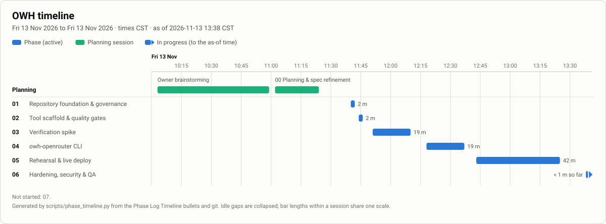
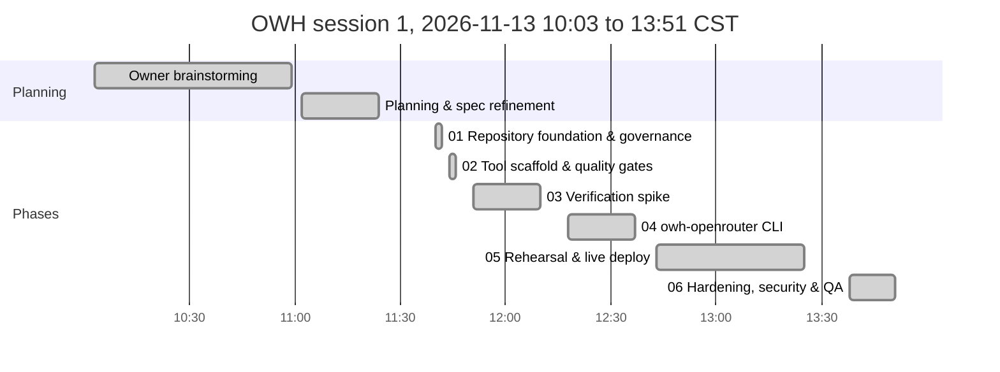
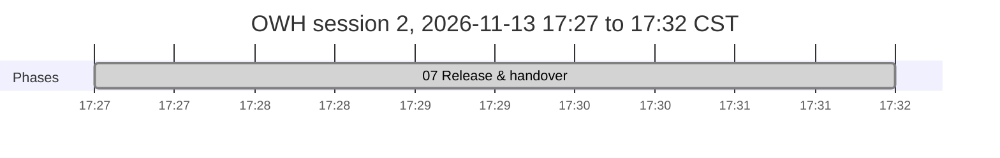

# OWH: Final Report (1.0.0)

**Project:** OpenWebUI Hybrid (OWH). **Released:** 2026-11-13 (Phases 00–07, one session day). **Repo:** `antonizick/OpenWebUI`, public from 2026-11-13 17:31 CST (MIT, ADR-0024).

## 1. What was built
Nick's OpenRouter account is now a second backend in his local Open WebUI (v0.13.3, Docker, host network, port 8080) next to Ollama. The model picker lists the local models and eight allowlisted OpenRouter models (prefix `OR.`); each chat goes to the backend of the model chosen. Titles, tags and follow-ups are generated by a local model (`qwen3:4b-instruct`), so they never go to OpenRouter.

The deliverable is `owh-openrouter`, a stdlib-only Python CLI (`set-key`, `models`, `apply`, `status`, `remove`) installed as `~/.local/bin/owh-openrouter`, plus a throwaway testbed (`scripts/owh-testbed.sh`), a test suite and the docs. The container, its unit, `Super+Alt+O`, OCC and `open-webui-upgrade` are unchanged. Guide: `docs/OWH_USER-GUIDE.md`.

## 2. Decisions
ADR-0001…0023 in `docs/OWH_DECISIONS.md`. The ones that shaped the result:
- 0001–0004: prefix `OWH`, a dedicated key, a curated prefixed allowlist, configuration through the admin API (stored config) rather than env vars.
- 0005: background tasks on a local model. 0006: stdlib-only CLI. 0007: rehearse on a throwaway container first.
- 0011–0013: testbed on host network bound to loopback; Open WebUI's attribution headers (spec R9 corrected); key validation via `GET /api/v1/key`.
- 0014: the eight-model allowlist. 0015: surgical `remove`. 0016: secret handling. 0017: `apply` keeps hand-made settings.
- 0018: no spend management in OWH. 0019: OpenRouter privacy allows logging/training providers.
- 0020: hidden prompts refuse without a terminal; consistent DB backup. 0021: port 8080 kept as is. 0022: snapshot retention. 0023: key-expiry warning.

## 3. Definition of done: evidence
| Item | Evidence |
|---|---|
| Picker shows local and allowlisted `OR.` models; each replies from its backend | Phase 05: `status` showed 8 OpenRouter + 5 local models; Nick's acceptance "both backends work, local and OpenRouter chats answered"; key usage $0.0173995 = rehearsal + his two turns |
| New chats default local; titles, tags, follow-ups local | ADR-0005; findings §4; Phase 05 rehearsal: 3 Ollama `POST /api/chat` and 1 upstream request per chat |
| OpenRouter unreachable: local still lists and works; delay recorded | Findings §8.3: `/api/models` 0.12–0.13 s with the port closed or unroutable; local chat 3.02 s |
| Survives a container recreate (`open-webui-upgrade` path), script unchanged | Findings §8.2; `tests/integration/test_hardening.py`: 5 OWH rows byte-identical after recreate |
| `apply` idempotent; `remove` restores exactly | Phase 05 live: second `apply` "already up to date"; Phase 04 testbed: 403 config rows restored byte-for-byte |
| Key in none of: repo and history, logs, `docker inspect`, shell history, process list | Findings §8.1 (0 hits in all of them; the key is only in its 0600 file and one `webui.db` row); `gitleaks detect`: no leaks (Phase 07, 2026-11-13 17:27 CST) |
| Dedicated key has a spending limit; privacy settings match Nick's answer | The key reports limit $50, monthly reset, set by Nick on openrouter.ai (OWH sets none on purpose, ADR-0018); privacy per ADR-0019 |
| Docs current | README, `docs/OWH_USER-GUIDE.md`, SECURITY, `docs/OWH_ARCHITECTURE.md`, this report, CHANGELOG 1.0.0, OSMods (`Open WebUI.md` + README), vault note |
| Repo up to date; throwaway containers, volumes, files removed | `gh repo view` (before the visibility change): `PRIVATE`; made public on Nick's explicit confirmation (ADR-0024); no `owh-test*` container or volume; `~/.local/state/owh/` holds only the live snapshot and log |

## 4. Spend during the build
Phases 00–04, 06: $0.00 (public endpoints and fakes). Phase 05: $0.0000077 (rehearsal chat) plus $0.0174 (Nick's UI check). Total on the key: **$0.0173995**, against a cap of $0.25 per phase.

## 5. Residual risks (threat model §7)
- Port 8080 listens on all interfaces while Open WebUI runs; ufw (default DROP), the login, signup off and API keys off protect it. Tailnet reachability could not be checked without root (ADR-0021).
- The key sits in clear text in `webui.db` and in every later backup of the volume (inherent to Open WebUI).
- `OR.` chats go to OpenRouter and to providers that may log or train (ADR-0019).
- Spend is bounded only by the key's limit on openrouter.ai, which Nick owns (ADR-0018).
- The key expires 2027-11-13; `status` warns from 30 days before.

## 6. Open items for Nick (not OWH's to change)
- `~/.bash_history` holds the AI Provider Switch key on an `ai-provider set-key` line. Remove the line and consider rotating that key (threat model §8).
- Optional: `chmod 600` the two 2026-11-09 manual backups in `~/.local/share/open-webui-backups/`.
- Host config: `mise use -g shellcheck@0.11.0` so `make lint` works in a plain shell.
- Owner question 4 (licence) answered: MIT, repo public (ADR-0024). Git history still contains the host's LAN and Tailscale addresses and the admin e-mail from earlier docs (removed from the current files); history was not rewritten.

## Timeline
<!-- phase-timeline:start (generated by scripts/phase_timeline.py; do not edit) -->

*Generated from the Phase Log Timeline bullets and git, as of 2026-11-13 17:32 CST. ≈ marks a time inferred from git or a heading. Idle gaps over 60 min start a new chart below and are collapsed in the image. Regenerate with `python3 scripts/phase_timeline.py --write`; do not edit by hand.*

| Phase | Name | Started | Finished | Merged | Active | Blocked | Claim |
|---|---|---|---|---|---:|---:|---|
| plan | Owner brainstorming | 2026-11-13 10:03 CST | 10:59 |  | 56 m |  | n/a |
| 00 | Planning & spec refinement | 2026-11-13 11:02 CST | 11:24 |  | 22 m |  | n/a |
| 01 | Repository foundation & governance | 2026-11-13 11:40 CST | 11:42 | 11:42 | 2 m |  | `a9c405b` |
| 02 | Tool scaffold & quality gates | 2026-11-13 11:44 CST | 11:46 | 11:46 | 2 m |  | `9eb5dff` |
| 03 | Verification spike | 2026-11-13 11:51 CST | 12:10 | 12:10 | 19 m |  | `879a1f8` |
| 04 | `owh-openrouter` CLI | 2026-11-13 12:18 CST | 12:37 | 12:37 | 19 m |  | `2bf3c35` |
| 05 | Rehearsal & live deploy | 2026-11-13 12:43 CST | 13:25 | 13:25 | 42 m |  | `0efb977` |
| 06 | Hardening, security & QA | 2026-11-13 13:38 CST | 13:51 | 13:51 | 13 m |  | `2a6aef1` |
| 07 | Release & handover | 2026-11-13 17:27 CST | 17:32 | 17:32 | 5 m |  | `01eb9f7` |

**Totals:** elapsed 7 h 29 m (first recorded start to 2026-11-13 17:32 CST) · active phase time 1 h 42 m (sum over phases) · blocked or paused 0 m · idle 3 h 36 m in 1 gap(s) over 60 min.
<!-- phase-timeline:end -->
